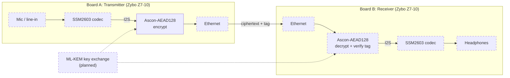
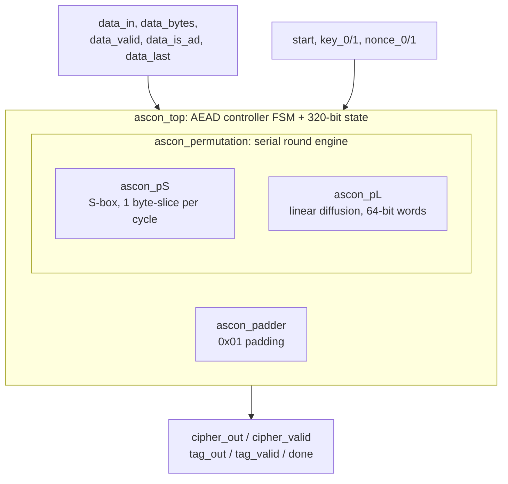
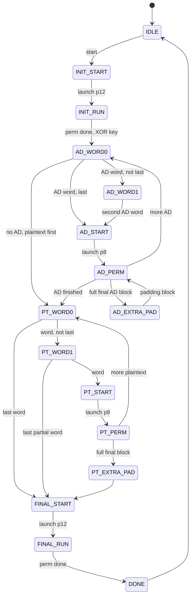
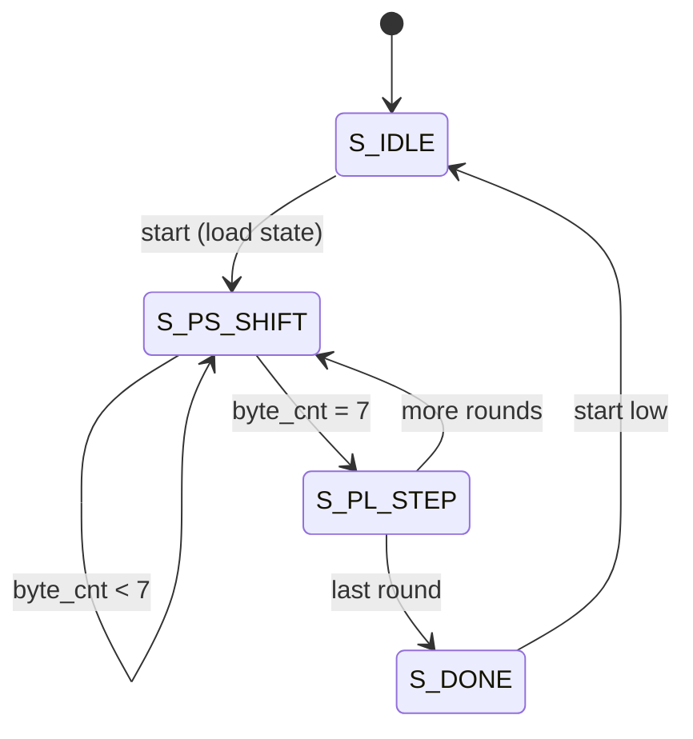

# Ascon-AEAD128 on FPGA for Secure Real-Time Audio Communication


-green)


A hardware implementation of the **Ascon-AEAD128** authenticated-encryption cipher in **SystemVerilog**, built as a Final Year Project (BS Computer Engineering, COMSATS University Islamabad). The goal is a **point-to-point encrypted voice link between two Zybo Z7-10 FPGA boards**: the first board captures audio and encrypts it in hardware, the second decrypts it and plays it back. A post-quantum key exchange (**ML-KEM**, NIST FIPS 203) is planned as the next phase.

> **Project status:** the Ascon-AEAD128 encryption core is complete and verified in simulation. Decryption, the audio codec interface, the Ethernet link and ML-KEM are in progress. See the [roadmap](#14-project-status-and-roadmap).

---

## Table of Contents

1. [Overview](#1-overview)
2. [Why Ascon?](#2-why-ascon)
3. [System Architecture](#3-system-architecture)
4. [Ascon-AEAD128 in Brief](#4-ascon-aead128-in-brief)
5. [RTL Architecture](#5-rtl-architecture)
6. [Module Descriptions](#6-module-descriptions)
7. [Top-Level Interface and Usage](#7-top-level-interface-and-usage)
8. [Finite State Machines](#8-finite-state-machines)
9. [Serial Permutation Engine and Timing](#9-serial-permutation-engine-and-timing)
10. [Verification](#10-verification)
11. [FPGA Implementation Results](#11-fpga-implementation-results)
12. [Design Considerations](#12-design-considerations)
13. [Known Limitations and Future Improvements](#13-known-limitations-and-future-improvements)
14. [Project Status and Roadmap](#14-project-status-and-roadmap)
15. [Tools and Technologies](#15-tools-and-technologies)
16. [Repository Structure](#16-repository-structure)
17. [Getting Started](#17-getting-started)
18. [References](#18-references)
19. [Team and Acknowledgements](#19-team-and-acknowledgements)

---

## 1. Overview

Quantum computers are expected to weaken much of today's public-key cryptography, and real-time audio is a demanding use case: any noticeable delay ruins the experience. This project builds the complete chain for a secure voice link on FPGA:

1. Capture audio on the transmitter board (SSM2603 codec over I²S).
2. Encrypt and authenticate each audio frame with **Ascon-AEAD128** in hardware.
3. Send the ciphertext and authentication tag to the second board over Ethernet.
4. Verify the tag, decrypt, and play the recovered audio.
5. *(Next phase)* Replace conventional key exchange with **ML-KEM**, making the whole link post-quantum end to end.

Doing encryption and decryption in dedicated hardware, rather than software, keeps latency low and leaves the processor free.

### Objectives

- Build Ascon-AEAD128 encryption and decryption in SystemVerilog and verify it on the FPGA board.
- Build a real-time audio link: audio captured at the transmitter is encrypted, sent, decrypted and played back at the receiver.
- Run the complete system on both boards and measure latency, FPGA resource usage and recovered-audio quality.

---

## 2. Why Ascon?

The project originally planned AES for encryption and ECC for key exchange. After a literature review and a C implementation of AES, the design was changed:

| Concern | AES + ECC (original plan) | Ascon-AEAD128 + ML-KEM (current plan) |
|---|---|---|
| Hardware cost | Larger area and resource use on a small FPGA | Small, lightweight permutation-based design |
| Authentication | Needs a mode such as GCM | Built into the AEAD construction |
| Standardisation | Established | Ascon is standardised by NIST for lightweight cryptography (SP 800-232) |
| Quantum resistance | ECC key exchange is not quantum-safe | ML-KEM (FIPS 203) is NIST's post-quantum key-encapsulation standard |

---

## 3. System Architecture

Planned end-to-end system (dashed blocks are not yet implemented):



**Implemented so far:** the Ascon-AEAD128 encryption core (`ascon_top` and its sub-modules), a C reference model, and a Vivado XSim verification environment.

---

## 4. Ascon-AEAD128 in Brief

Ascon-AEAD128 is a sponge-based authenticated-encryption scheme built around a single 320-bit permutation.

| Parameter | Value |
|---|---|
| State size | 320 bits (five 64-bit words `s[0]` … `s[4]`) |
| Key / Nonce / Tag | 128 bits each |
| Rate / Capacity | 128 bits / 192 bits |
| Initialisation and finalisation | 12-round permutation (p12) |
| Data processing | 8-round permutation (p8) |
| IV constant | `64'h00001000808c0001` |

**Operation phases** (as implemented in `ascon_top`):

1. **Initialisation:** load IV, key and nonce into the state, run p12, XOR the key into the last two state words.
2. **Associated data:** absorb 128-bit blocks (as two 64-bit words) with p8 between blocks, then apply domain separation.
3. **Plaintext:** XOR each word with the state to produce ciphertext, with p8 between full blocks.
4. **Finalisation:** XOR the key into the capacity, run p12, and output the 128-bit tag.

The permutation itself has three layers per round: *round-constant addition*, a 5-bit *substitution layer* (S-box) applied bit-sliced across the five words, and a *linear diffusion layer* (per-word rotations and XORs).

---

## 5. RTL Architecture



The design separates **message-level control** (`ascon_top`) from **round-level processing** (`ascon_permutation`). The top module owns the 320-bit state register and handshakes with the permutation through `start` / `done` signals; the permutation module uses a separate working copy of the state while a round sequence runs.

---

## 6. Module Descriptions

| Module | File | Function |
|---|---|---|
| `ascon_top` | `rtl/ascon_top.sv` | Top-level AEAD controller. Holds the 320-bit state, sequences initialisation, associated-data, plaintext and finalisation, and manages the input/output handshakes. |
| `ascon_permutation` | `rtl/ascon_permutation.sv` | Serial, iterative round engine. Applies the round constant, runs the S-box one byte-slice per clock, then the linear layer in one clock. Supports p12 and p8. |
| `ascon_pS` | `rtl/ascon_pS.sv` | Combinational 5-bit S-box applied to one 8-bit slice across the five state words (bit-sliced form). |
| `ascon_pL` | `rtl/ascon_pL.sv` | Combinational linear diffusion layer. Each word XORs itself with two rotated copies (rotation pairs 19/28, 61/39, 1/6, 10/17, 7/41). |
| `ascon_padder` | `rtl/ascon_padder.sv` | Formats a partial final word: places `0x01` directly after the last valid byte (0 to 8 valid bytes). |

---

## 7. Top-Level Interface and Usage

### Ports of `ascon_top`

| Port | Dir | Width | Description |
|---|---|---|---|
| `clk` | in | 1 | System clock |
| `rst_n` | in | 1 | Asynchronous, active-low reset |
| `start` | in | 1 | Begin a new AEAD transaction (accepted in `IDLE`) |
| `ready` | out | 1 | High while the core is idle |
| `done` | out | 1 | Pulses when the tag is available |
| `key_0`, `key_1` | in | 64 each | 128-bit key (must stay stable until `done`) |
| `nonce_0`, `nonce_1` | in | 64 each | 128-bit nonce |
| `data_in` | in | 64 | Associated-data or plaintext word |
| `data_bytes` | in | 4 | Number of valid bytes in `data_in` (used on the last word) |
| `data_valid` | in | 1 | `data_in` holds a valid word |
| `data_is_ad` | in | 1 | `1` = associated data, `0` = plaintext |
| `data_last` | in | 1 | Last word of the current data class |
| `data_ready` | out | 1 | Core can accept a word |
| `cipher_out` | out | 64 | Ciphertext word |
| `cipher_valid` | out | 1 | `cipher_out` is valid (one-cycle pulse per word) |
| `tag_out` | out | 128 | Authentication tag |
| `tag_valid` | out | 1 | `tag_out` is valid |

### Typical encryption sequence

1. Apply `key_*` and `nonce_*`, and pulse `start` while `ready` is high.
2. Wait for `data_ready`. Send associated-data words with `data_is_ad = 1` (set `data_last` on the final one). If there is no associated data, go straight to plaintext.
3. Send plaintext words with `data_is_ad = 0`, setting `data_last` and `data_bytes` on the final word.
4. Collect each `cipher_out` when `cipher_valid` pulses.
5. When `tag_valid` / `done` pulses, read `tag_out`.

---

## 8. Finite State Machines

### Top-level controller (`ascon_top`)



The controller handles full and partial final words using `data_bytes` and `data_last`, selects the **p12** schedule for initialisation and finalisation and the **p8** schedule for data, and applies the domain-separation bit between associated data and plaintext.

### Permutation engine (`ascon_permutation`)



---

## 9. Serial Permutation Engine and Timing

Instead of instantiating the full 320-bit S-box layer, the engine processes **one 8-bit slice of all five state words per clock** and rotates the state right by one byte each cycle:

- **Substitution layer:** 8 clocks per round (one byte-slice per clock). The round constant is added to the low byte of `s[2]` on the first slice.
- **Linear layer:** 1 clock per round (all five 64-bit words in parallel).
- After 8 slices the state bytes are back in their original order.

| Operation | Rounds | Clocks per round | Approx. clocks* |
|---|---|---|---|
| Initialisation / finalisation (p12) | 12 | 8 + 1 = 9 | ~108 |
| Data block (p8) | 8 | 8 + 1 = 9 | ~72 |

\* Excluding one state-load cycle and the controller's handshake overhead. Exact figures should be taken from simulation.

**Back-of-envelope throughput (not yet measured):** one 128-bit block needs roughly 75–80 clocks, so throughput is about `128 × f_clk / 80`. Even at a modest 10 MHz this is on the order of 16 Mbit/s, comfortably above the ~1.5 Mbit/s needed for 48 kHz, 16-bit stereo audio. Real figures will be reported once the full system is measured.

---

## 10. Verification

### Strategy

| Level | Method | Status |
|---|---|---|
| Algorithm | C reference implementation checked against the official Ascon test vectors | ✅ Done |
| RTL (functional) | Vivado XSim simulation of `ascon_top` against **1,065 known-answer test vectors** | ✅ Done |
| Edge cases | Partial-word padding (0–8 valid bytes) and transitions between associated data and plaintext | ✅ Covered by the vectors |
| Hardware | Encryption module synthesised on FPGA | ✅ Synthesis OK |
| Hardware integration | Full-system test with audio on two boards | ⏳ Planned |

Outputs (ciphertext and tag) are compared against expected values from the test-vector set. These checks demonstrate **functional correctness of the RTL**; FPGA timing, resource use and audio-link performance are reported separately once measured.

### Testbenches

| Testbench | Purpose |
|---|---|
| `Ascon.srcs/sim_1/new/tb_ascon.sv` (module `tb_ascon`) | Directed top-level test of `ascon_top` |
| `Ascon.srcs/sim_1/new/tb_ascon2.sv` (module `tb_kat`) | Known-answer test: runs the vectors in `sim/test_vectors/kat.mem` and compares ciphertext and tag |


---

## 11. FPGA Implementation Results

**Target board:** Digilent Zybo Z7-10 (Xilinx Zynq-7000, XC7Z010)
**Tool:** Vivado *(add version)*

### Resource utilisation (post-synthesis, `ascon_top`)

| Resource | `ascon_top` (total) | `ascon_permutation` | Device capacity | Utilisation |
|---|---|---|---|---|
| Slice LUTs | 1,274 | 938 | 17,600 | ~7% |
| Slice registers (flip-flops) | 734 | 334 | 35,200 | ~2% |
| F7 muxes | 1 | 1 | 8,800 | <1% |
| BRAM / DSP | 0 / 0 | 0 / 0 | – | 0% |

The serial permutation engine accounts for most of the logic (938 of 1,274 LUTs); the rest is the AEAD controller FSM and the padder.

> The I/O count reported when `ascon_top` is synthesised on its own (527 bonded IOBs) reflects its wide 64/128-bit ports and is **not** a cost of the core. In the final system these ports connect to internal logic, not to package pins.

---

## 12. Design Considerations

- **Area versus throughput.** A serial, iterative core processes one S-box byte-slice per clock, so the substitution logic is about one eighth of a fully parallel round. This trades throughput for a much smaller footprint, which suits resource-constrained targets and audio-rate data.
- **Hardware over software.** Keeping encryption in the datapath gives predictable, low latency for real-time audio.
- **Data-independent control flow.** The permutation runs a fixed number of clocks per round regardless of the data, which is a good starting point for constant-time behaviour. Formal side-channel evaluation is future work.
- **Handshake-based interface.** `data_valid` / `data_ready` and `start` / `done` signalling lets the core be wrapped easily in AXI-Stream or a codec front-end.
- **Key stability.** The key is used again during the transaction (after initialisation and before finalisation), so `key_0` / `key_1` must be held constant until `done`.
- **Asynchronous active-low reset** is used on all registers.

---

## 13. Known Limitations and Future Improvements

**Current limitations**

- `ascon_top` implements the **encryption** direction only. The decryption path (and tag verification) is still in progress.
- `cipher_out` is not masked for a partial final word: only the first `data_bytes` bytes are meaningful and the consumer must truncate.
- The design is simulated against test vectors; on-board timing and resource data are still to be added.

**Planned improvements**

- Decryption mode with **tag comparison**, rejecting altered or unauthenticated frames before any audio is released.
- Codec interface (SSM2603 over I²S) and Ethernet framing between the two boards.
- **ML-KEM** (FIPS 203) key exchange for a post-quantum key-establishment flow.
- Optional unrolled-round variant to compare area and throughput.
- Self-checking testbench with SystemVerilog assertions and an automated regression script.
- Masking and side-channel evaluation of the final design.
- Ascon-Hash / XOF modes and an AXI-Stream wrapper.

---

## 14. Project Status and Roadmap

| Task | Status | Target |
|---|---|---|
| Study of AES and C implementation (ruled out for constrained FPGA) | ✅ Completed | Aug 2026 |
| Literature review (Ascon-AEAD128, FPGA implementations) | ✅ Completed | Aug 2026 |
| Ascon-AEAD128 C reference, verified against official vectors | ✅ Completed | Aug 2026 |
| Ascon-AEAD128 encryption in SystemVerilog | ✅ Completed | Oct 2026 |
| Test cases and functional verification | ✅ Completed | Oct 2026 |
| Synthesis and implementation on FPGA | 🔄 In progress (encryption synthesised) | Oct 2026 |
| Decryption module and bitstream generation | 🔄 In progress | – |
| Two-board communication (Ethernet) | ⏳ Planned | Jan 2027 |
| Audio codec integration (I²S) | ⏳ Planned | Feb 2027 |
| Functional verification (codec and Ethernet) | ⏳ Planned | Feb 2027 |
| ML-KEM implementation | ⏳ Planned | Apr 2027 |
| End-to-end system testing and verification | ⏳ Planned | Apr 2027 |

---

## 15. Tools and Technologies

| Category | Tool / Technology |
|---|---|
| HDL | SystemVerilog |
| Simulation | Vivado Simulator (XSim) |
| FPGA board | Digilent Zybo Z7-10 (Xilinx Zynq-7000) |
| Synthesis / implementation | Vivado |
| Reference model | C |
| Audio codec | SSM2603 (I²S) |
| Cryptography | Ascon-AEAD128 (NIST SP 800-232), ML-KEM (NIST FIPS 203) |
| Version control | Git and GitHub |

---

## 16. Repository Structure

```
fpga-ascon-aead128-secure-audio/
├── Ascon.xpr                      # Vivado project (open this file)
├── Ascon.srcs/
│   ├── sources_1/new/             # RTL design sources
│   │   ├── ascon_top.sv
│   │   ├── ascon_permutation.sv
│   │   ├── ascon_pS.sv
│   │   ├── ascon_pL.sv
│   │   └── ascon_padder.sv
│   └── sim_1/new/                 # testbenches
│       ├── tb_ascon.sv
│       └── tb_ascon2.sv           # known-answer test (tb_kat)
├── sim/
│   └── test_vectors/
│       └── kat.mem                # known-answer test vectors
├── c_reference/                   # C implementation verified against official vectors
├── docs/
│   ├── progress_report.pdf
│   └── images/
├── constraints/                   # .xdc pin constraints (to be added)
├── .gitignore
├── LICENSE
└── README.md
```

> Vivado-generated folders (`Ascon.cache`, `Ascon.runs`, `Ascon.sim`, `Ascon.hw`, `Ascon.ip_user_files`) are intentionally not tracked; Vivado recreates them when the project is opened and run.

---

## 17. Getting Started

### Simulation (Vivado XSim)

1. Open `Ascon.xpr` in Vivado.
2. Make sure `sim/test_vectors/kat.mem` is added as a simulation source (**Add Sources → Add or create simulation sources**, untick "Copy sources into project" if you want it to stay in `sim/test_vectors/`).
3. In **Simulation Settings**, set the simulation top module to `tb_kat` (known-answer test) or `tb_ascon` (directed test).
4. Click **Run Simulation → Run Behavioral Simulation** and check the Tcl console for the pass/fail summary.

### Synthesis

1. Create a new project for the **Zybo Z7-10** (`xc7z010clg400-1`).
2. Add all files in `rtl/` as design sources.
3. Add your constraints file and run synthesis and implementation.

---

## 18. References

1. C. Dobraunig, M. Eichlseder, F. Mendel, and M. Schläffer, "Ascon v1.2: Lightweight Authenticated Encryption and Hashing," *Journal of Cryptology*, vol. 34, no. 3, 2021. doi: 10.1007/s00145-021-09398-9
2. NIST, "Module-Lattice-Based Key-Encapsulation Mechanism Standard," FIPS 203, August 2024.
3. H. Groß, E. Wenger, C. Dobraunig, and C. Ehrenhöfer, "Suit up! Made-to-Measure Hardware Implementations of ASCON," *Euromicro DSD*, 2015. doi: 10.1109/DSD.2015.14
4. H. Groß et al., "Ascon hardware implementations and side-channel evaluation," *Microprocessors and Microsystems*, 2016. doi: 10.1016/j.micpro.2016.10.006
5. A. R. Alharbi et al., "Evaluating Ascon Hardware on 7-Series FPGA Devices," *IEEE Access*, 2024. doi: 10.1109/ACCESS.2024.3471694
6. M. Mirigaldi, V. Piscopo, M. Martina, and G. Masera, "The Quest for Efficient ASCON Implementations: A Comprehensive Review of Implementation Strategies and Challenges," *Chips*, 2025. doi: 10.3390/chips4020015
7. Digilent, "Zybo Z7 Board Reference Manual," Rev. B, 2018.

---

## 19. Team and Acknowledgements

**Final Year Project, BS Computer Engineering, COMSATS University Islamabad**

- Muhammad Umair Khan ([@umair608500](https://github.com/umair608500))
- Qazi M. Suleman Khalid
- Rohan Kiani

**Supervision:** Dr. Syed Saud Naqvi (Supervisor), Dr. Haroon Ahmed Khan (Co-Supervisor)

---

## License

Released under the MIT License. See [`LICENSE`](LICENSE).

> If you find this project useful, consider giving it a ⭐.
